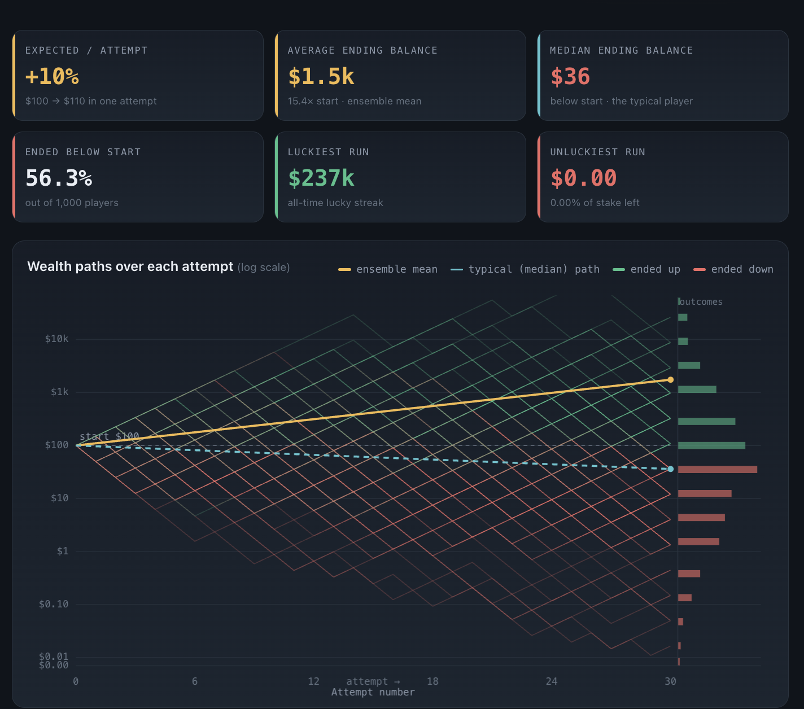

This is a concept I read in Nassim Taleb's book *Fooled by Randomness*. It's only briefly explained there, but it's a very interesting idea.

Let's say a stock has a 60% probability of giving a 50% return and a 40% probability of giving a 50% loss. The expected return on average for $100 would be:

```
0.6 * $100 * (1 + 0.5) + 0.4 * $100 * (1 - 0.5) = $110
```

which is 10%.

Another way to look at it: take a group of 10 people who invested $100 each. 6 of them made a profit ending at $150, and 4 of them made a loss ending at $50. On average the group made $110, and if they pool the money and distribute it equally, each person walks away with $10 on top of their $100. This is an **ensemble average**.

Now, let's say a single person invests $100 and keeps reinvesting in sequence:

```
1st investment   -> success -> $150
2nd reinvestment  -> success -> $225
3rd reinvestment  -> success -> $337.5
4th reinvestment  -> loss    -> $168.75
5th reinvestment  -> loss    -> $84.375
```

Even though the returns and probabilities never changed, the person ended up with a loss. This is called a **time average**.

The time average return for this works out to:

```
(1.5)^0.6 * (0.5)^0.4 - 1 = -0.0334
```

which is approximately -3.34%.

In the ensemble average, the events are independent of each other, which makes the outcome additive and the returns positive. In the time average, the events aren't independent, each bet compounds on the last which makes it multiplicative and the returns turn negative.

Now let's combine both, where ensemble averaging and time averaging happen at the same time. Assume 1,000 players who each make a sequence of 30 investments with a starting amount of $100.



The ensemble average comes to $1.5k, so if the group shares the amount equally, that's a pretty good return per person.

But if the group acts individualistically, 56.3% of the players lost money. The $1.5k average is driven by a handful of extremely lucky players, one of them making $237k. If this Monte Carlo simulation is rerun, the exact stats change, but they stay roughly in this range.

And if you increase the number of attempts further, even more players end up under water.
