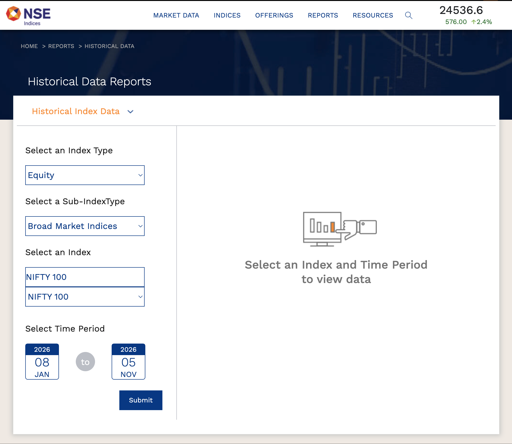
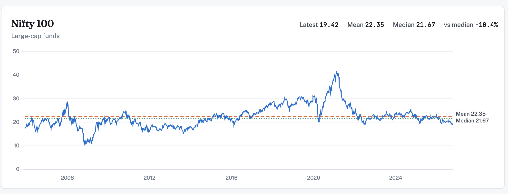
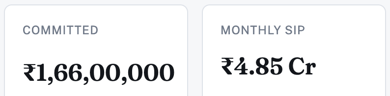
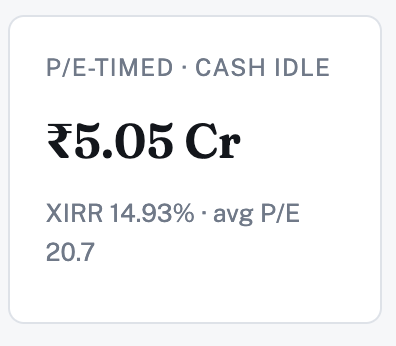
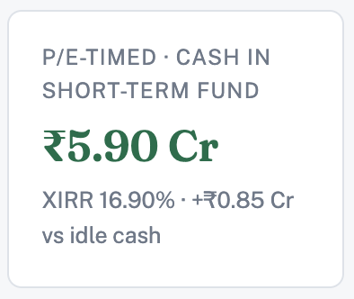
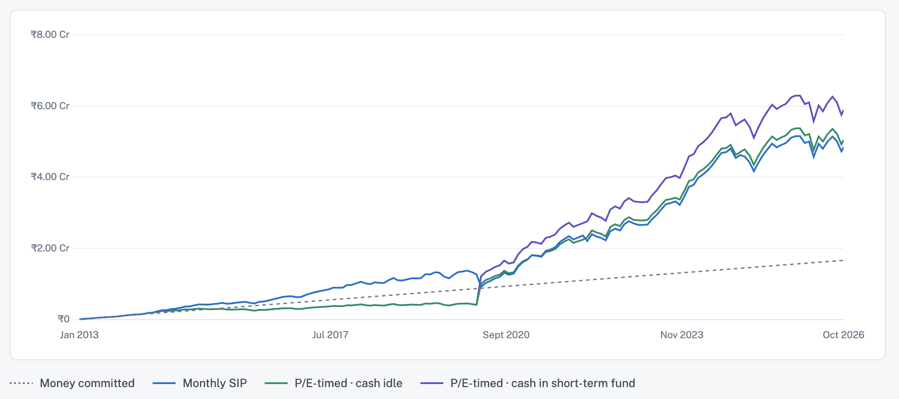

The most common Systematic Investment Plan that everyone uses is the monthly fixed investment into  assets such as stocks, gold, mutual funds etc. 

Fixed income assets don't have the volatility / Beta of Equities because of which there is not much that can be done in terms of the monthly investment once you have set your asset allocation.

There are strategies that can be done with equity in terms of the SIP that can help with getting more returns. The stock market goes through various phases, it can be costly or cheap. SIP helps in averaging out the ups and downs of the stock market and helps with getting the average return.

There are moments in the stock market that it is costly to buy the mutual funds and thats an opportunity to hold onto the money so that it can be invested when it is closer to the average or below average.

Since I'm in India, the historical P/E ( Price to Earnings) ratios are available at https://www.niftyindices.com/reports

Nifty 100 data goes back to early 2000s. There are other datasets available too such as sectoral and segments - Mid, Small cap etc.

Plotting and taking average/median of the Nifty 100, the average P/E comes at 22.35 and median is 21.67.  The COVID years pushed the stock market up and also made the stocks more costly so the actual average would be closer to around 19 to 20ish.

For the sake of simplicity, I'm going to assume 1 lakh investment per month from Jan 2013 to 2026 October into a single fund - Nippon India Large Cap Fund.

The strategy is simple. Take the rolling average of the P/E from the beginning of time if the current P/E is less than or equal to the rolling average then do the SIP and if not then accumulate the money till the current PE <= rolling average P/E 

Investing 1L every month results in 1.66 Cr invested which gets valued at 4.85 Cr by 2026  October

If the simple strategy is used of not investing when P/E is above average then the same amount gets valued at 5.05 Cr which is a 20 lakhs increase

Its an increase but not a substantial increase. Building upon the strategy, instead of parking the cash, invest it in a short term duration fund like ICICI Prudential Short Term Fund then the value of the investment goes to 5.9 Cr

Parking the money in a fixed income asset when the market is costly and then deploying it when it becomes cheaper is an obvious thing to do which most people don't. 

The strategy can be enhanced more by creating various other trigger points for deployment and parking cash along with reliable asset allocation to maximize the returns. The intention with this post was to show the simulation of simple strategy that can be easily done by anyone. 