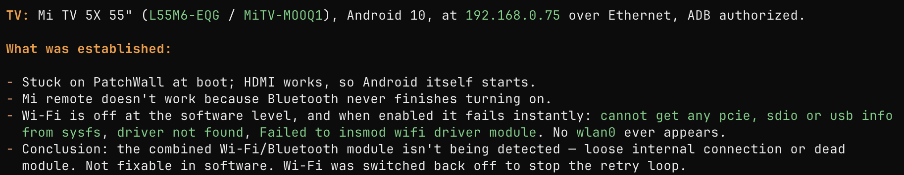

I've a Mi TV QLED  (L55M6-EQG) which I bought in 2021. 

A year back, it got stuck on the PatchWall Screen ( Mi's native app) and I couldn't navigate to the native android screen. Thankfully I have an Apple tv box and was able to switch to the HDMI port manually and use the TV with the Apple TV box.

I wasn't sure if the issue was with the software or the hardware. Searched online if there was anything related to this issue with Mi or Android TV but couldn't find anything. 

Few weeks back, I read a post on Twitter/X where the person accessed the android TV via Android adb ( Android Debug Bridge) using Claude Code and was able to remove any unnecessary apps that were present and freed up a lot of memory.

I was curious what Claude would say about my TV so connected a keyboard to the TV to enable the developer mode on the Android TV and used an ethernet cable to connect the TV to my wifi router. 

Fired up Claude and let it loose on my TV. 

Finally, it confirmed what I thought was the most probable cause which was that the Wifi and Bluetooth hardware is not working and there was not much that I could do. 

This lays to rest a mystery that bothered me for a year.

